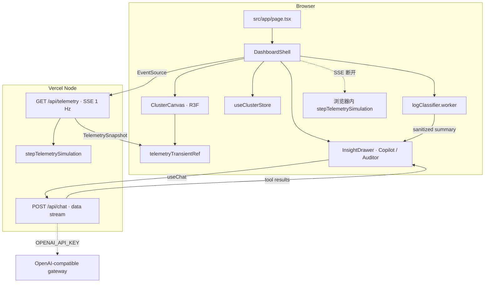

# KubeVision AI

云原生三维态势感知台。把一座 Kubernetes 集群画成可导航的 WebGL 拓扑，在浏览器里完成日志脱敏与分类，再把脱敏摘要交给云端副驾驶做根因诊断。没有模型密钥时，副驾驶仍用同一套生成式 UI 协议给出可演示的诊断。

| 项 | 值 |
| --- | --- |
| 应用 | Next.js 14.2 App Router · React 18 · TypeScript 5.9 |
| 画布 | React Three Fiber 8 · three 0.170 · 60 FPS 实例化渲染 |
| 端侧 | Transformers.js 2.17 · Web Worker · WebAssembly |
| 云端 | Vercel AI SDK 4 · Tool Calling · 可选 OpenAI 兼容网关 |
| 状态 | Zustand 5 · 离散 UI 与瞬态遥测分轨 |
| 仓库 | https://github.com/dada628/kubevision-ai |

## 定位与核心亮点

KubeVision AI 是一块 SRE 指挥台，不是又一块指标折线图。控制面、三台计算架、Pod、服务流量和故障涟漪都在同一坐标系里。高频数字不进 React，面板只按秒刷新摘要。

- **三维拓扑。** `MasterNode3D`、`WorkerRack3D`、`PodInstancedMesh`、`NetworkStream3D`、`ErrorRippleRing` 全部程序化建模，不依赖 glTF。每个机架的 Pod 共用一个 `InstancedMesh`，一架一次绘制。
- **生成式运维 UI。** 副驾驶通过 Vercel AI SDK 的 `streamText` 调用 `renderPodMetrics`、`renderRootCauseAnalysis`、`proposeRemediationAction`。工具结果直接长成指标卡、根因卡和待确认的自愈指令。执行前停在人工确认。
- **端侧隐私审计。** 容器日志在 Web Worker 里分类和脱敏。原始密钥、口令和内网地址留在浏览器。只有带 `[REDACTED_IP]`、`[MASKED_TOKEN]` 的摘要能被送去云端深挖。
- **无密钥可演示。** `OPENAI_API_KEY` 缺失、占位或上游在首包前失败时，`/api/chat` 改走确定性仿真流。协议仍是 AI SDK data stream，评审环境零配置即可走完工具卡。
- **帧率保护。** 视口离开屏幕或标签页隐藏时画布 `frameloop` 切到 `never`。帧率持续低于 40 时把 `dpr` 降到 1、星尘从 120 降到 40。`Shift+P` 打开性能遥测。

## 技术栈命中矩阵

| 赛题要求 | 本仓库落点 | 结果 |
| --- | --- | --- |
| Next.js 14+ App Router | `src/app/page.tsx` 保持 Server Component，只导出 metadata 并挂载客户端壳。`/api/chat`、`/api/telemetry` 为 Route Handler，均 `dynamic = 'force-dynamic'`、`runtime = 'nodejs'`、`maxDuration = 30`。WebGL 经 `next/dynamic({ ssr: false })` 进入，`three` 不进 RSC 图。 | 命中 |
| React Three Fiber 3D 拓扑 | `src/components/canvas/ClusterCanvas.tsx` 承载场景。控制面、三台 Worker 机架、实例化 Pod、服务间流光、故障涟漪环构成集群拓扑。 | 命中 |
| Vercel AI SDK 生成式 UI 与 Tool Calling | `ai@4.3` 的 `useChat` 对接 `POST /api/chat`。`streamText` + `tool()` 产出三张卡片；无密钥时仿真器写出同一条 data stream。 | 命中 |
| Transformers.js 端侧离线隐私推理 | `src/workers/logClassifier.worker.ts` 在 Worker 内动态加载 `@xenova/transformers`，模型 `Xenova/distilbert-base-uncased-finetuned-sst-2-english`。权重进浏览器缓存。脱敏后的摘要才离开本机。 | 命中 |
| Zustand 双轨瞬态存储 | `useClusterStore` 保存选中对象、混沌场景、终端和抽屉等离散状态。`telemetryTransientRef` 是模块级可变快照，`useFrame` 直接读，不触发 React 重渲染。摘要约 1 Hz 再提交给 HUD。 | 命中 |

## 系统架构



页面本身是服务器组件。交互、Zustand 和 WebGL 都在 `DashboardShell` 以下。画布、遥测流和日志 Worker 各挂载一次，避免两条时间线写进同一个瞬态池。

## 端云协同

1. 浏览器抓取当前集群的合成容器日志。
2. 唯一的 Web Worker 做分类，并在本地把 IP、令牌和口令换成固定标记。终端只回写 `[EDGE-WASM]` 事件，不回写日志正文。
3. 分类为 `CRITICAL_PANIC` 或 `RESOURCE_EXHAUSTED` 时，操作者可以把**脱敏摘要**送进副驾驶。抽屉切回 Copilot，原始文本不进入请求。
4. `POST /api/chat` 读取随请求附带的集群快照。工具 `execute` 用快照覆盖模型填写的数字，卡片不会和三维场景打架。
5. 自愈动作停在 `pending_confirmation`。确认与否留在界面里，不由模型直接执行。

可选环境变量只在服务端读取：

| 变量 | 作用 |
| --- | --- |
| `OPENAI_API_KEY` | 有可用密钥时走 `streamText`。空值、`changeme`、占位符则走仿真流。 |
| `OPENAI_BASE_URL` | OpenAI 兼容网关。主机名含 `deepseek` 时默认模型 `deepseek-chat`，含通义域名时默认 `qwen-plus`。 |
| `OPENAI_MODEL` | 显式模型名，覆盖上面的推断。未设置且直连 OpenAI 时为 `gpt-4o-mini`。 |

## 双模遥测

集群数字来自 `stepTelemetrySimulation`，每秒一帧，产出完整 `TelemetrySnapshot`。采集器就是这套合成引擎。

| 模式 | 路径 | 行为 |
| --- | --- | --- |
| 服务端 SSE | `GET /api/telemetry?mode=demo\|live&chaos=<场景>` | 每个连接一份独立状态。帧零在 `start()` 里同步写出。`Cache-Control: no-cache, no-transform`，并拒绝 CDN 缓存。`mode` 与 `chaos` 回写在 `X-Telemetry-Mode`、`X-Telemetry-Chaos`。 |
| 浏览器降级 | `useTelemetryStream` 的本地定时器 | `EventSource` 建连失败或中途出错时关闭连接，同一套引擎在页面内继续走。终端打出降级原因。改连接模式或混沌场景会重新尝试 SSE。 |

顶栏把 `live` 显示为 tunnel、`demo` 显示为 synthetic。两条路径共用这套仿真引擎：`mode` 写入查询参数，并反映在顶栏徽标上。Vercel 上这条函数的 `maxDuration` 为 30 秒，到点连接会被平台回收，页面按上表降级，拓扑继续动。

混沌场景从顶栏演练面板写入 `activeChaos`，SSE 查询和本地续跑使用同一个场景值。

## 在线演示

**Live Demo：** `https://kubevision-ai.vercel.app`

这是生产地址占位，仓库里还没有绑定已验证的 Vercel 域名。第一次生产发布后，用 CLI 打印的 Production URL 替换上一行。未配置 `OPENAI_API_KEY` 时，在线环境仍应完整走出三维拓扑、端侧审计和仿真副驾驶。

## 本地启动

依赖锁是 `package-lock.json`。Node.js `>= 18.17`。

```bash
npm install
npm run dev
```

浏览器打开 http://localhost:3000 。

需要云端模型时，在项目根创建 `.env.local`（已被 git 忽略）：

```bash
OPENAI_API_KEY=sk-...
OPENAI_BASE_URL=https://api.openai.com/v1
OPENAI_MODEL=gpt-4o-mini
```

常用脚本：

| 命令 | 作用 |
| --- | --- |
| `npm run dev` | 开发服务器 |
| `npm run lint` | `next lint` |
| `npm run typecheck` | `tsc --noEmit` |
| `npm run build` | 生产构建 |
| `npm run start` | 运行上一次构建 |

本机若只通过 Corepack 提供 pnpm、且没有 `pnpm-lock.yaml`，审计命令用 `corepack pnpm tsc --noEmit` 与 `corepack pnpm run build`。日常安装仍以 npm 锁为准。

## 生产发布

`.gitignore` 已忽略 `node_modules`、`.next/`、`.env` 与 `.env*.local`。不要把密钥提交进仓库。在 Vercel 项目的 Environment Variables 里配置上一节的三个变量。

```bash
npx vercel login
npx vercel link
npx vercel --prod
```

`vercel.json` 把 `/api/chat` 与 `/api/telemetry` 的函数时长设为 30 秒，为两条接口加上禁缓存头，并为全站加上 `nosniff`、`Referrer-Policy`、`X-Frame-Options: SAMEORIGIN` 与权限策略。路由文件里的 `maxDuration` 与这份配置一致。
